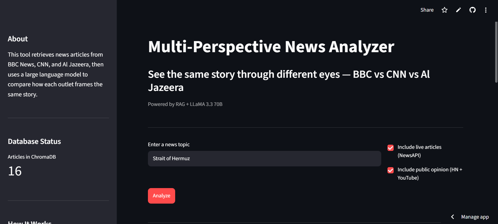
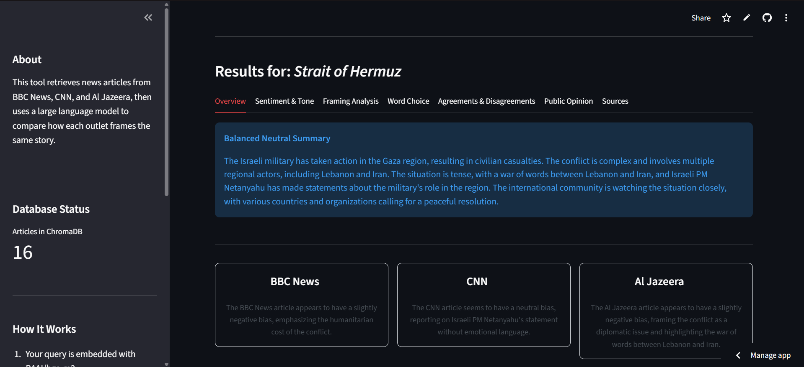
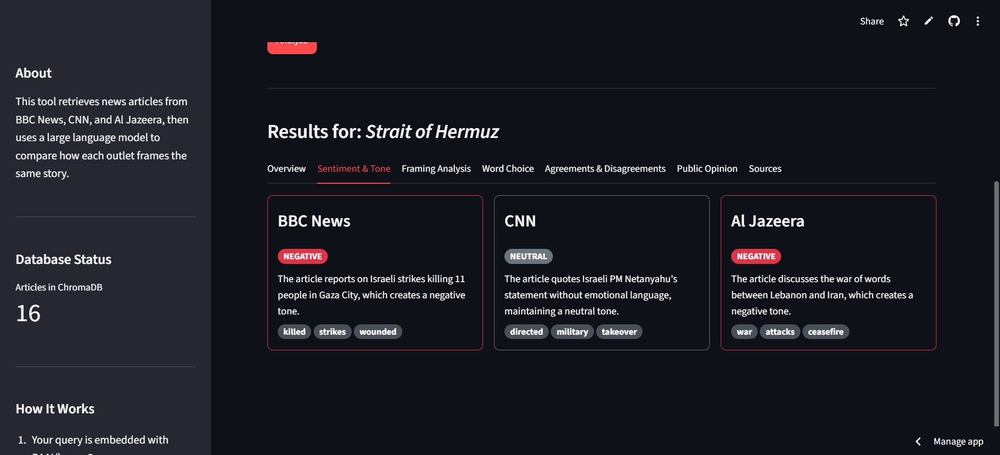
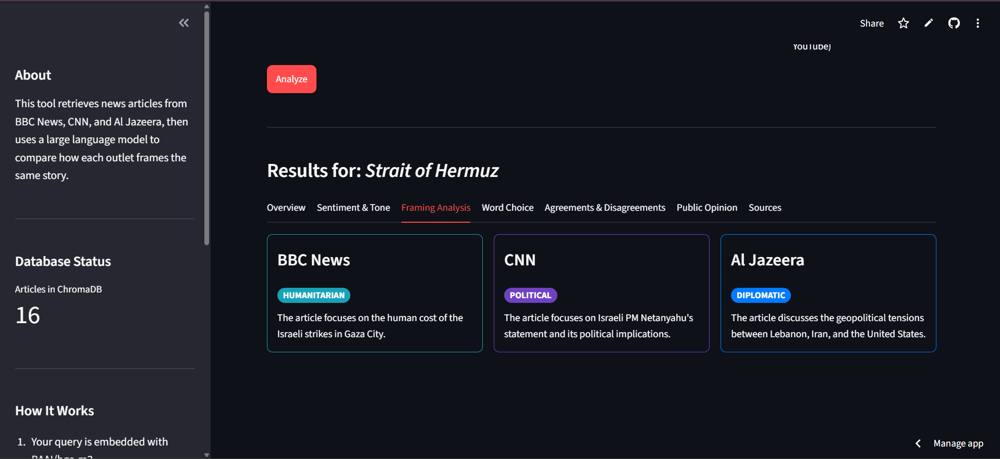
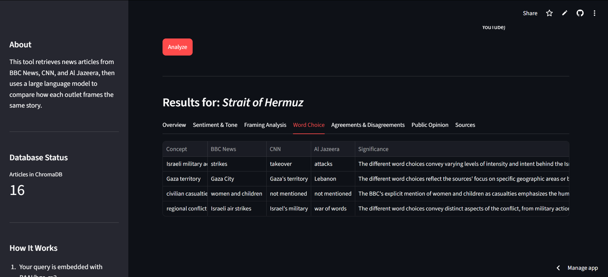
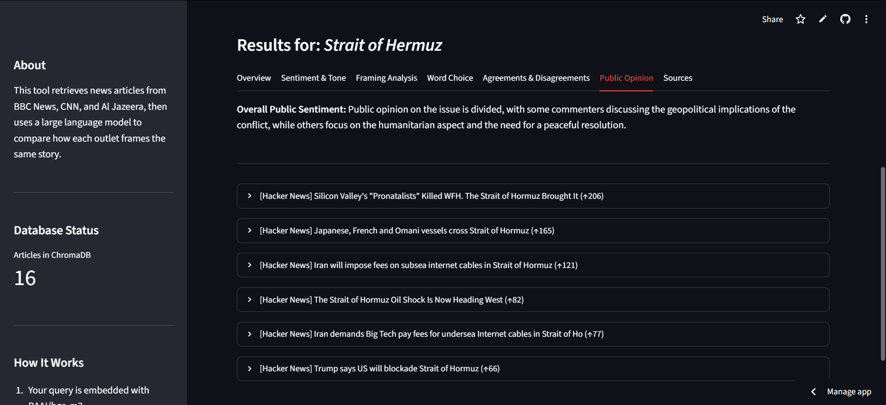
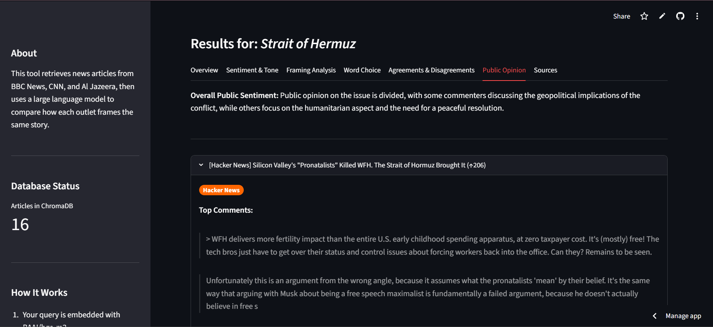
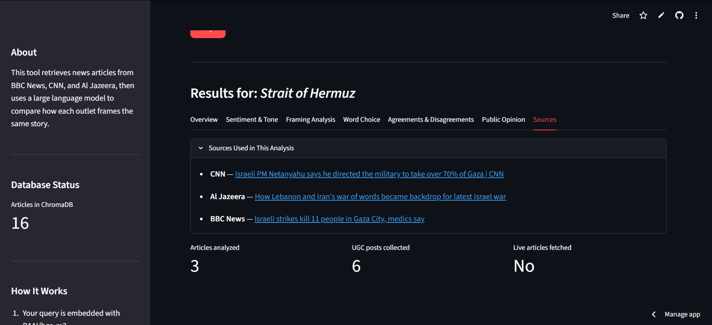

# Multi-Perspective News Analyzer

Live demo: https://newsanalyzerai.streamlit.app/

Multi-Perspective News Analyzer is a Streamlit application that compares how major news outlets frame the same story. It combines retrieval-augmented generation, vector search, reranking, and LLM analysis to surface differences in tone, sentiment, framing, word choice, omissions, and public opinion.

## What This Project Does

- Retrieves related coverage from BBC News, CNN, and Al Jazeera.
- Searches a local ChromaDB knowledge base built from news article embeddings.
- Optionally pulls live articles from NewsAPI for current events.
- Collects public opinion signals from Hacker News and YouTube.
- Uses a large language model to produce a structured, side-by-side analysis.
- Presents the result in a polished Streamlit UI with tabs for overview, sentiment, framing, sources, and public opinion.

## Why It Is Useful

This project is designed to help readers, analysts, and recruiters quickly understand how media narratives change across sources. Instead of showing only raw search results, it turns the same event into a structured comparison that highlights bias, omissions, and differences in interpretation.

## Key Features

- Multi-source comparison across BBC News, CNN, and Al Jazeera.
- Retrieval pipeline with embeddings, ChromaDB, and reranking.
- Optional live fetching for timely article coverage.
- Public opinion aggregation from Hacker News and YouTube.
- Structured AI output with sentiment, framing, omissions, and summary sections.
- Cached results for faster repeat analysis.
- Streamlit sidebar controls to clear cache or reload the database.

## Tech Stack

- Python
- Streamlit
- LangChain
- ChromaDB
- sentence-transformers
- Torch / Transformers
- NewsAPI
- PRAW
- Google Gemini
- Groq

## Architecture Overview

1. The user enters a news topic in the Streamlit UI.
2. The app embeds the query and retrieves relevant article chunks from ChromaDB.
3. Optional live articles are fetched from NewsAPI.
4. A reranker selects the most relevant evidence.
5. The LLM analyzes the evidence and returns structured JSON.
6. The UI renders the results in a recruiter-friendly dashboard.

## Screenshots

The images below are pulled directly from `docs/screenshots/`.

### Query Input and Controls


### Overview Tab


### Sentiment and Tone


### Framing Analysis


### Word Choice Comparison


### Public Opinion


### Top comments drop down view


### Sources Tab


### Agreements and Disagreements


## Getting Started

### Prerequisites

- Python 3.10+
- pip

### Installation

```bash
git clone https://github.com/mahrooshishaq/AI_powered_multiperspective_newsAnalyzer.git
cd AI_powered_multiperspective_newsAnalyzer
pip install -r requirements.txt
```

### Environment Variables

Create a `.env` file in the project root and add your API keys:

```bash
NEWSAPI_KEY=your_newsapi_key
GROQ_API_KEY=your_groq_key
GEMINI_API_KEY=your_gemini_key
REDDIT_CLIENT_ID=your_reddit_client_id
REDDIT_CLIENT_SECRET=your_reddit_client_secret
```

### Build the Local Database

Run ingestion once to populate the local ChromaDB store:

```bash
python data/ingest.py
```

### Run the App Locally

```bash
streamlit run app.py
```

Then open the app in your browser at http://localhost:8501.

## Deployment

This project is deployed on Streamlit Cloud. To reproduce the deployment:

1. Push the repository to GitHub.
2. Connect the repository in Streamlit Community Cloud.
3. Set the app entry point to `app.py`.
4. Add the required secrets in the Streamlit Cloud settings.

## Configuration Notes

- The app expects news articles from BBC News, CNN, and Al Jazeera.
- The retrieval layer uses `BAAI/bge-m3` embeddings.
- Reranking uses `cross-encoder/ms-marco-MiniLM-L-6-v2`.
- The main analysis model is `llama-3.3-70b-versatile`.
- If live articles are unavailable, the app can still analyze indexed data.

## Project Structure

```text
app.py                  # Streamlit entry point
analysis/               # Prompting, analysis orchestration, LLM client
config/                 # Constants and app settings
data/                   # Ingestion pipeline
retrieval/              # Embeddings, ChromaDB, search, reranking
social/                 # Hacker News, Reddit, and YouTube public opinion fetchers
ui/                     # Streamlit layout and reusable UI components
utils/                  # Cache, logging, and text helpers
```

## Limitations

- NewsAPI free-tier content can be truncated.
- The embedded knowledge base may contain older CC-News articles, so live fetching is important for current events.
- The app depends on several external APIs, so response quality can vary with key availability and rate limits.
- The first run can take longer because the embedding and reranking models may need to download.

## Recruiter Notes

This project demonstrates experience with:

- Retrieval-augmented generation
- Media analysis and narrative comparison
- LLM orchestration and structured JSON output
- Streamlit product design
- API integration and caching
- Vector databases and semantic search

## License

No license has been added yet. Add one if you plan to open-source the repository.
